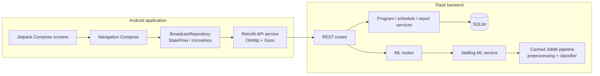
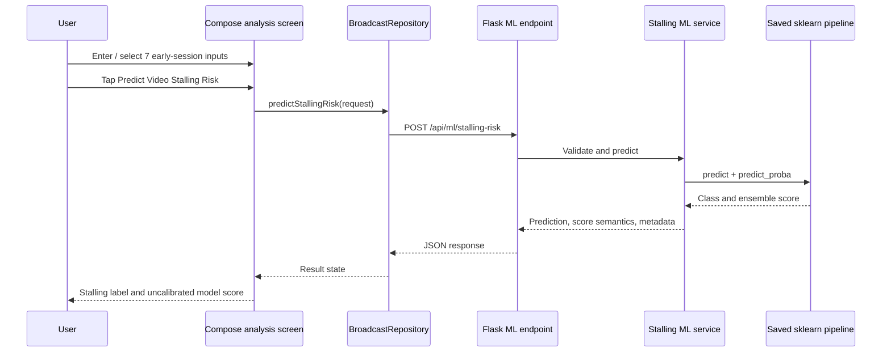
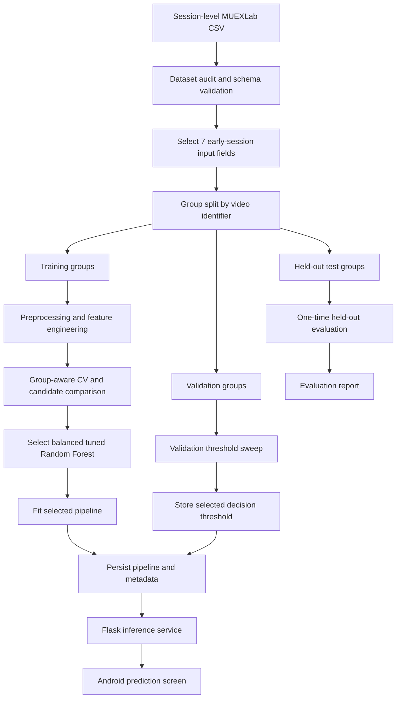

Digital Broadcast Monitoring — Android + Machine Learning
An Android application for broadcast-program and schedule management, operational reports, and alert review, extended with a machine-learning feature that predicts early-session video-streaming stalling risk from network-traffic measurements.
Scope note: The Android application is a broadcast-monitoring management prototype. Its ML component is trained on the MUEXLab video-streaming QoE research dataset and predicts stalling in encrypted IP video-streaming sessions. It does not measure live television RF signals, transmitter health, SDI faults, black frames, or audio clipping.

Contents
- Project Overview
- Features
- Technology Stack
- System Architecture
- Machine-Learning Workflow
- Dataset and Feature Engineering
- Model Evaluation
- ML Inference API
- Project Structure
- Run Locally
- Testing
- Limitations and Responsible Interpretation
- Dataset Attribution and Research Reference
Project Overview
Digital Broadcast Monitoring combines a native Android application with a Flask backend. The application provides screens for managing programs and broadcast schedules, viewing operational summaries and reports, and reviewing alerts. The backend exposes REST endpoints for application data and ML inference.

The ML extension addresses a related streaming-quality problem: given network measurements from the first ten seconds of a video session, predict whether that session will experience stalling. The prediction is served by Flask using a persisted scikit-learn pipeline and displayed in the Android Broadcast Analysis & Streaming QoE screen.

The project therefore contains two related but distinct capabilities:
1. Broadcast-management workflows: program and schedule management, schedule-rule validation, reports, and alerts.
2. Streaming QoE prediction: supervised ML inference over early-session network-traffic features from a research dataset.
Features
Android application
- Native Android UI built with Kotlin and Jetpack Compose Material 3.
- Multi-screen navigation for Home, Programs, Schedule, Reports, analysis, and supporting app screens.
- Program and schedule workflows, including add, edit, detail, and list views.
- State-driven UI using Kotlin StateFlow and repository-backed application state.
- Operational dashboard, report summaries, and alert presentation.
- Broadcast schedule validation for overlapping intervals and invalid chronological sequences.
- Streaming QoE analysis screen with editable model inputs, clearly labelled research presets, loading states, API error handling, and prediction results.
Backend and ML
- Flask REST API for application data and model inference.
- SQLite-backed application data layer (for the existing management workflows).
- A persisted scikit-learn preprocessing-and-classification pipeline loaded and cached by the inference service.
- Input validation for categorical values, required fields, and numeric throughput values.
- Group-aware dataset splitting by video identifier to reduce train/test leakage between sessions of the same video.
- Model comparison, threshold analysis, evaluation scripts, and automated backend tests.
Technology Stack
Layer	Technologies
Android	Kotlin, Android SDK, Jetpack Compose, Material 3, Navigation Compose
Android state and data	StateFlow, repository pattern, Kotlin coroutines
Android networking	Retrofit, OkHttp, Gson
Backend	Python, Flask, REST API
Application persistence	SQLite
Machine learning	pandas / NumPy, scikit-learn, Random Forest, Joblib
ML preprocessing	ColumnTransformer, imputers, encoders, scaling, custom throughput-dynamics transformer
Testing	Python unittest, JUnit / Android Gradle test tasks
Build	Gradle, Android Gradle Plugin, Android Studio JDK

System Architecture
The Android client communicates with the Flask backend through the existing Retrofit service and repository layer. Application-management routes handle program, schedule, dashboard, report, and alert data. The ML route sends prediction requests to a dedicated service, which validates the seven input values and runs inference using the saved pipeline.

ML prediction request flow

Machine-Learning Workflow
The selected task is a binary classification problem:
- 0 / False: no stalling occurred.
- 1 / True: stalling occurred.
The model uses measurements available within the first ten seconds of the session. It does not use the full-session target columns or the video identifier as a predictor.

Training and validation strategy
- Dataset rows are grouped by the video identifier before splitting. Sessions belonging to the same video are kept within one split.
- Reported split sizes: 21,179 training sessions, 4,498 validation sessions, and 4,516 held-out test sessions.
- Reported video groups: 1,358 training videos, 291 validation videos, and 291 test videos.
- The reported split checks found zero video-ID overlap between train, validation, and test.
- Candidate selection uses group-aware cross-validation and validation-set metrics. The held-out test partition is kept for final evaluation rather than model selection.
Feature engineering
The API continues to accept the same seven input fields. A custom EarlyThroughputDynamicsTransformer derives six additional numeric features from the three throughput measurements:
Derived feature	Definition	Interpretation
ratio_5_1	(T5 + 1) / (T1 + 1)	Relative change between first- and five-second throughput windows
ratio_10_5	(T10 + 1) / (T5 + 1)	Relative change between five- and ten-second throughput windows
delta_10_1	T10 - T1	Difference between ten-second and first-second throughput
t_min	min(T1, T5, T10)	Minimum of the three early throughput measurements
t_mean	mean(T1, T5, T10)	Average of the three early throughput measurements
log_t10	log(1 + T10)	Log-transformed ten-second throughput

T1, T5, and T10 represent dl_throughput_first1s, dl_throughput_first5s, and dl_throughput_first10s, respectively, measured in Bytes/s. The derived values are calculated inside the persisted pipeline so training and inference use the same transformation logic.
Dataset and Feature Engineering
Dataset source
The project uses the MUEXLab video-streaming QoE session dataset associated with research by Michael Seufert and Irena Orsolic. The dataset contains video-on-demand streaming measurements collected in Würzburg and Zagreb across 2020 and 2021. The supplied session-level CSV used for this project contains:
Dataset property	Reported value
Measurement rows	30,193
Columns	119
Distinct video groups	1,940
Duplicate rows	0
No-stalling records	18,619 (61.67%)
Stalling records	11,574 (38.33%)

The raw dataset is kept outside version control. See Dataset Attribution and Research Reference for the source record and paper.
Model input schema
The inference API expects these seven fields:
Input	Type	Allowed values / unit
year	Categorical	2020, 2021
location	Categorical	Wuerzburg, Zagreb
bandwidth	Categorical	unlimited, 1Mbps, stochastic
adblock	Categorical	0, 1
dl_throughput_first1s	Numeric	Bytes/s
dl_throughput_first5s	Numeric	Bytes/s
dl_throughput_first10s	Numeric	Bytes/s

The video field is used for group splitting and leakage checks only; it is not an ML input. Other dataset targets are not used as predictors.
Model Evaluation
The improved model is reported as a RandomForest_Balanced_Tuned classifier with:
- n_estimators = 200
- max_depth = 16
- class_weight = "balanced_subsample"
- Six throughput-dynamics features derived within the pipeline
- Validation-selected classification threshold: 0.50
Fourteen candidate configurations were reported as evaluated using five-fold video-group cross-validation and a separate validation partition. The selected configuration was chosen using validation macro F1, with stalling precision/recall and balanced accuracy also considered.
Baseline vs. improved model — held-out test set
Metric	Baseline v1.0.0	Improved v1.1.0
Model	Random Forest (100 trees)	Balanced tuned Random Forest (200 trees, depth 16)
Accuracy	78.74%	80.07%
Balanced accuracy	76.74%	79.09%
Macro F1	0.7713	0.7899
ROC-AUC	0.8574	0.8728
PR-AUC	0.8136	0.8281
Stalling precision	74.20%	73.54%
Stalling recall	68.19%	74.90%
Stalling F1	0.7107	0.7421
False negatives (missed stalls)	550	434

The reported v1.1.0 test result reduces false negatives by 116 sessions (21.1%) compared with the baseline, while increasing false positives from 410 to 466. This is a trade-off: more stalling sessions are detected, with more non-stalling sessions flagged as stalling.
Improved model confusion matrix
Rows are actual classes; columns are predicted classes. Class 0 is no_stalling, and class 1 is stalling.
	Predicted no stalling	Predicted stalling
Actual no stalling	2,321	466
Actual stalling	434	1,295

Decision threshold
A threshold sweep was performed on the validation partition. The reported threshold of 0.50 maximized validation macro F1 (0.8016) among the evaluated thresholds. Lower thresholds increased stalling recall but also increased false positives. The configured threshold is stored in model metadata and used by the inference service.
Score interpretation: The API's stalling_risk_score is derived from RandomForestClassifier.predict_proba() and is explicitly labelled uncalibrated_model_estimate. It is an uncalibrated ensemble-vote estimate, not a calibrated probability that a real-world stream will fail.

ML Inference API
The Flask backend exposes the following ML endpoints:
Method	Endpoint	Purpose
GET	/api/ml/health	Reports model readiness, version, and expected input schema
POST	/api/ml/stalling-risk	Validates early-session inputs and returns a stalling prediction

Example request
POST /api/ml/stalling-risk
Content-Type: application/json
{
  "year": "2021",
  "location": "Wuerzburg",
  "bandwidth": "unlimited",
  "adblock": "0",
  "dl_throughput_first1s": 500000,
  "dl_throughput_first5s": 600000,
  "dl_throughput_first10s": 700000
}
Response fields
The response includes the predicted class and label, the uncalibrated stalling-risk score, score semantics, decision threshold, model identity/version, inference latency, submitted inputs, and research-data provenance. Invalid or missing fields are rejected with 400 Bad Request; an unavailable or unloadable model returns 503 Service Unavailable rather than a fabricated prediction.
Android emulator networking
For the Android emulator, the app uses the host-machine bridge address:
http://10.0.2.2:5000/
For local PowerShell tests on the development machine, use:
http://127.0.0.1:5000/
Project Structure
The following is the main implementation structure (some Android UI and application files are omitted for brevity):
DigitalBroadcastMonitoring/
├── app/
│   └── src/
│       ├── main/java/com/example/digitalbroadcastmonitoring/
│       │   ├── data/
│       │   │   ├── api/                 # Retrofit client and API service
│       │   │   ├── api/dto/             # Request/response DTOs
│       │   │   └── repository/          # BroadcastRepository and state
│       │   └── ui/
│       │       ├── navigation/          # Compose navigation
│       │       └── screens/             # Home, Programs, Schedule, Reports, Analysis
│       └── test/                        # Android unit tests
├── backend/
│   ├── app.py                           # Flask application entry point
│   ├── routes/
│   │   └── ml_routes.py                 # ML health and stalling-risk routes
│   ├── services/
│   │   └── stalling_ml_service.py       # Cached model loading and inference
│   ├── ml/
│   │   ├── config.py                    # Features, target and provenance
│   │   ├── data_loader.py               # Dataset loading and group splits
│   │   ├── pipeline.py                  # Preprocessing and feature engineering
│   │   ├── audit_dataset.py             # Dataset audit
│   │   ├── experiment_tuning.py         # Candidate experiments and tuning
│   │   ├── train_pipeline.py             # Training and persistence
│   │   ├── evaluate_pipeline.py          # Held-out evaluation
│   │   ├── models/
│   │   │   ├── stalling_pipeline.joblib  # Persisted fitted pipeline
│   │   │   └── stalling_metadata.json    # Model metadata and threshold
│   │   └── data/
│   │       ├── raw/                      # Downloaded source data (git-ignored)
│   │       └── audit_report.json         # Dataset audit output
│   └── tests/                            # Backend unit and API tests
├── gradle/                               # Gradle wrapper and version catalog
└── README.md
Run Locally
1. Clone the repository
git clone https://github.com/piyushisingh/DigitalBroadcastMonitoring.git
cd DigitalBroadcastMonitoring
2. Download and place the research dataset
Download the session-level CSV and its description file from the University of Zagreb repository record. Place them at:
backend/ml/data/raw/session-dataset.csv
backend/ml/data/raw/session-dataset-description.txt
The raw data directory is intentionally excluded from Git. You must obtain the files from the source repository before running the audit or training scripts.
3. Prepare the backend environment
Use the Python dependency manifest included in backend/ to install the project's dependencies. If creating a fresh virtual environment on Windows:
py -3 -m venv backend\.venv
# Activate it if desired:
.\backend\.venv\Scripts\Activate.ps1
Install the dependencies from the backend requirements file included in the repository, then run the audit and model pipeline from the project root.
4. Audit, train, and evaluate
.\backend\.venv\Scripts\python.exe backend/ml/audit_dataset.py
.\backend\.venv\Scripts\python.exe backend/ml/experiment_tuning.py
.\backend\.venv\Scripts\python.exe backend/ml/train_pipeline.py
.\backend\.venv\Scripts\python.exe backend/ml/evaluate_pipeline.py
The training process writes the fitted pipeline and metadata under backend/ml/models/.
5. Start the Flask backend
.\backend\.venv\Scripts\python.exe backend\app.py
The development server listens on port 5000. Keep it running while testing the Android app. The Flask development server is for local development only; do not expose it as a production deployment.
6. Build and run the Android app
Open the project in Android Studio, allow Gradle sync to complete, select an emulator/device, and run the app configuration.

For command-line builds on Windows using the Android Studio bundled JDK:
$env:JAVA_HOME = "C:\Program Files\Android\Android Studio\jbr"
.\gradlew.bat testDebugUnitTest --no-daemon
.\gradlew.bat assembleDebug --no-daemon
Testing
The implementation report records the following verification results:
Check	Reported result
Dataset audit	30,193 rows, 119 columns, no duplicate rows
Group-split leakage check	Zero video-ID overlap across train, validation, and test
Backend test suite	39 tests passed
Android unit tests	Passed
Android debug build	assembleDebug succeeded
Live ML API	Health and prediction endpoints returned successful responses
Input validation	Missing, invalid categorical, and malformed numeric inputs rejected

Re-run the commands in Run Locally to reproduce results in your own environment. Reported outcomes may vary if dependency versions, source data, random seeds, model settings, or code are changed.
Limitations and Responsible Interpretation
- Research domain: The ML model predicts video-on-demand streaming stalling from encrypted IP traffic features in the MUEXLab research dataset. It is not trained on television broadcast transmitter telemetry.
- Not a physical signal detector: It does not directly detect RF transmission faults, SDI faults, black frames, audio clipping, or EBU R128 violations.
- Early prediction horizon: The model uses measurements from the initial ten seconds. Network degradation that begins later in a long session may not be reflected in those inputs.
- Manual/demo inputs: The Android analysis form accepts user-entered values and research presets. The application does not automatically capture these measurements from live broadcast hardware.
- Uncalibrated score: The displayed score is an uncalibrated Random Forest ensemble estimate, not a calibrated real-world failure probability.
- Dataset shift: The reported evaluation uses held-out video groups from the same research collection. Performance on other streaming platforms, networks, geographies, devices, or production broadcast systems has not been established.
- False alarms and missed events: At the reported v1.1.0 threshold, the held-out test set contained 466 false positives and 434 false negatives. Threshold choice reflects a precision/recall trade-off.
- Model artifact trust: Only load the Joblib artifact generated by this project's trusted training process. Do not load model files from untrusted sources.
Dataset Attribution and Research Reference
The session-level dataset is attributed to the Multimedia Experience Laboratory (MUEXLab), with measurements associated with the University of Zagreb and the University of Würzburg. The repository record identifies the dataset as open access and displays a Creative Commons Attribution notice; consult the source record for the applicable licence version and reuse conditions.

Dataset record: Video streaming datasets: Improving the Transfer of Machine Learning-Based Video QoE Estimation Across Diverse Networks

Related publication:

Michael Seufert and Irena Orsolic, “Improving the Transfer of Machine Learning-Based Video QoE Estimation Across Diverse Networks,” IEEE Transactions on Network and Service Management, vol. 21, no. 3, pp. 2824–2836, 2024. https://doi.org/10.1109/TNSM.2023.3326664

Please retain the dataset authors' attribution and cite the underlying research when using or redistributing the data in accordance with the source licence.
Project note: The ML module is an additional streaming QoE prediction capability within the broader Digital Broadcast Monitoring Android application. Its outputs should be interpreted within the scope of the research dataset and evaluation described above.
